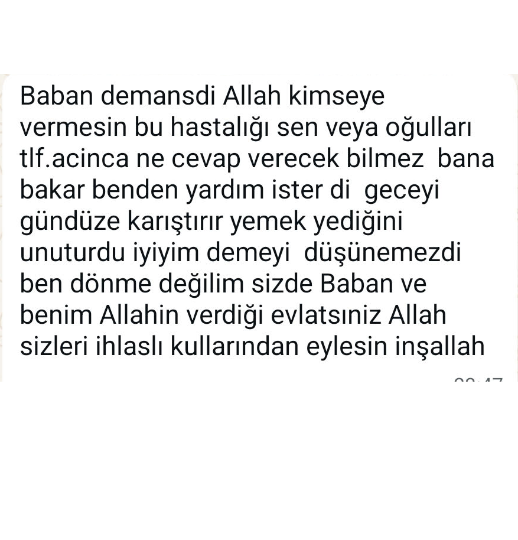

Bu yaziyi ilkin, 7 Aralik 2025'de <a href="https://donmeler.blogspot.com/2025/12/anam-donme-fedakar-ana.html">https://donmeler.blogspot.com/2025/12/anam-donme-fedakar-ana.html</a>'da yayinladim. Simdi, icerigini degistirmeden buraya aktariyorum. 

---

# Babam'a İftira

Donme, Babam’in arkasindan da laf cakiyor.  
Donme meger donme degilmis.   
Babam demans oldugu icin filan mi, o aralarda derelerden .. .. meger Babam mi oyle dusunmus/demis..  Tam belli/belirgin degil – yok. Istedigi tarafa cevrilebilir laf. “Bu denenler donmenin donmeligine dair lafin Babam’in son zamanlarindaki durumuyla ilgisini diyor/cagristiriyor” diyecem ama yok – tam ortadan – haksizlik olur donmeye, tam oyle dememis donme. “sana oyle geliyor, hep kotusunden dusunuyorsun” dese, e “hak”li donme. Donmenin dediginin ustune mi diyecez zaten. 

Kasim Gumus’un ve anam-donme torunlarinin donmeligi meselesi yaklasik bi 18 senelik is ve benim tesbitimdir. Babam’in ortaya cikarmis vb hicbir durumu yok. Babam’a atfedilecek hicbir tarafi yok – cek uzat yine olmaz. Ben tesbit edip Babam’a soyledim, ordan cikti ve 18 sene once. Ve bunu anam-donmenin bilmemesine imkan yok. Ilk ciktigi o 18 sene onceki zamandan beri. Hadi onu birak – ben taa kac senedir, en az bi 10 sene telefonda dedim Babam’la konusurken. Imkan yok bilmemesine. Hani analigimin o dedigi – sufle ettigi telefonlarda. Donme simdi ancak sunuyor donme olmadigini, cunku bana araci olarak surdugu eski tanidiklardan birine dedim – o isine gelmedi. Ondan. Ve, 5 sene once bu dunyadan ayrilmis Babam’a iftira etmek pahasina yapiyor bunu. 

Bu kadin bir pisliktir.   
Bu kadin bir pisliktir. 

2005-2006 o aralar 1 sene donmelerin bir isyerinde calistim. Tescilli adi belli donme kurumu. Sagim solum onum yanim donme’ymis. Ondan once pek bilmezdim. Donmeleri az/ufak, hatta pek kalmamis bir grup filan, ama senin-benim gibi kimseler sanirdim. Bu kadar ayri/derin, inanilmaz sekilde ikiyuzlu, tereyagindan kil ceker gibi degil de “analarinin ak sutu gibi” hirsiz/yalanci olduklarini hala saskinlikla gorurum. Anam donmede bu dedigim her turlu “marifet”in turlu turlu renklerini omur boyu gordugum halde. Donmelik baska birseydir.  
O zamanlar (o kurumda olan biteni gordukten sonra) arastirmaya basladim ve epeyce calistim. Yalcin Kucuk’un calismalari bu konuda baslicadir-- benim arastirmamda en azindan en buyuk kaynak o oldu. Donmelerin kendi dedikleri bazi seylerden, hele bir tanesi bu anam-donmenin kendi agzindan kacirdigi bir seyle bire bir tesbitlidir. Kasim Gumus, donmedir. Bu boyledir.  
Donmelik bir kisilik, kafa/dusunce ve herseyden once bir gonul isidir. Kalitsal (etnik ya da kulturel) birsey degildir. Oyle oldugunu, hele donmeden olanin/doganin donme oldugunu varsaymak Allah’in yarattigini gozardi/inkar etmek olur. Kasim Gumus, halis mulis donmedir. Anam donme ve annannemin diger cocuklari (bunlar toplam 3) safi donmedir. Anam donmenin oglu Refik de tam onlardandir. Tatli tatli calarlar. Calar, ustune mahzunlasir, borc cikarir.. lar. Artik ne lazimsa. Anam donmenin bi slogani vardi “yavuz hirsiz ev sahibini kovar” diye. Bu cok dogrudur – kac kere olmustur. 

Annannem donme degildir – asla. Ici disi bir muslumandi. Icinde birsey tutamazdi zaten. Aksine – Annannem donmenin zilgitini (kizkardesi Sevval) evir-cevir yemis, yine de icinden boyle cikmistir. Kizlari da analarini baskilardi. Ama annannem onlardan vazgecmezdi annelik duygusundan. Babam bana dedi bir keresinde, ben uzulmeyim, beklenmedik birseyde kirilmayim diye “annannen bilse de kizini tercih eder” diye. Babam belki kendine boyle oldugu icin. Annannem Babam’i severdi “kendi oglum gibi .. bakti sahiplendi.. Allah razi olsun..” ama anam-donmenin Babam’in arkasindan konusmadigi durum/zaman yok. Ikisi de – Annannem ve Babam rahmetle uyusun. Yattiklari yer cennet olsun. 

Halil (kardesim) de donme degildir-- asla. Alakasi yoktur. Haksizliga iftiraya yalana dayanamaz. 

Kursagindan haram lokma gecmez. Ne onun, ne de coluk cocugunun. Ama, haramzadelerle yandaslik ediyor bana karsi. Bilerek ve bilmeyerek. Benim hakkimda hic kimse, istese inansa bile olumlu birsey diyemez dusunemez. Dusunse bile soyleyemez. Anam-donme herkesten onde gider oyle birsey olacak olsun. Musvik, fedakar, “sacini supurge eden..” anan seni atmis seni kim n’apsin. Beni kollamakla, butun bu 10yillarca kotulenmis dislanmis herturlu “bencil”ligi “narsist”ligi “kotu dusunceli”ligi “fesat”ligi “hukmedici”ligi .. <su an aklima gelenler> fersah fersah, her yerde, evir cevir, en basta anam-donme ve takimi (anam donmenin donme kizkardesleri, anam donmeyle yarisir paslasirlar) tarafindan soylenmis yerlestirilmis birini kollamakla herkesi karsisina alacak. I. Husam’in ogullari dahil, ve belki en basta. Bana onlarin laflarini getirip diyordu. I.Husam’in anadan tescilli hirsiz, babadan tescilli alcak ogullarinin. Hayata cikmamis kiz cocuguna sokak kizi muamelesi yapan i.Husam’in ogullarinin. 

Halil’e hic bir kuskunlugum yok. HICBIR zaman kotulugunu istemem ve istemedim. Kardes kardese kizar. Dovusur, kavga eder, sinirlenir. Hele boyle bir ortamda. Ama HICBIR zaman kotulugunu istemedim. Ve istemem. Dilerim (ve hep diledim) ailesiyle mutlu olsun. Allah tamamina erdirsin, agiz tadiyla ve dirlikle, mutlulugu daim olsun esi cocuklariyla. Uzerindeki hakkim helaldir. Olan/olmayan ne hakkim varsa gonulden helaldir ve hep oyle olacak. Ama, gorusmeyi yakinlasmayi konusmayi vs HIC istemiyorum. Boyle bir girisim direk saldiri/taciz/zulumdur. Baska baska iki insaniz. Son 40 senedir ne konustuk Halil’le. Simdi olsak ne konusacaz. Artik bitmistir. Dogrusu budur. Bu boyledir. 

Anam-donmenin yuregi yag baglardi. Baglasin. 

Artik kalmadi. 

Halil’e ve cocuklarina ailesine hakkim helal, dileklerim iyidir. Icten. Taa gonulden. Laf olsun, durumu yumusatmak babinda filan degil.  
Ama bir girisim/gorme/yakinlasma zulum/taciz/saldiridir. Omrumuzun geri kalan tum zamaninda. Kirginligim, bi gonul-alacagim/verecegim yok. Ama dilerim Allah birbirimize muhtac etmesin. 

